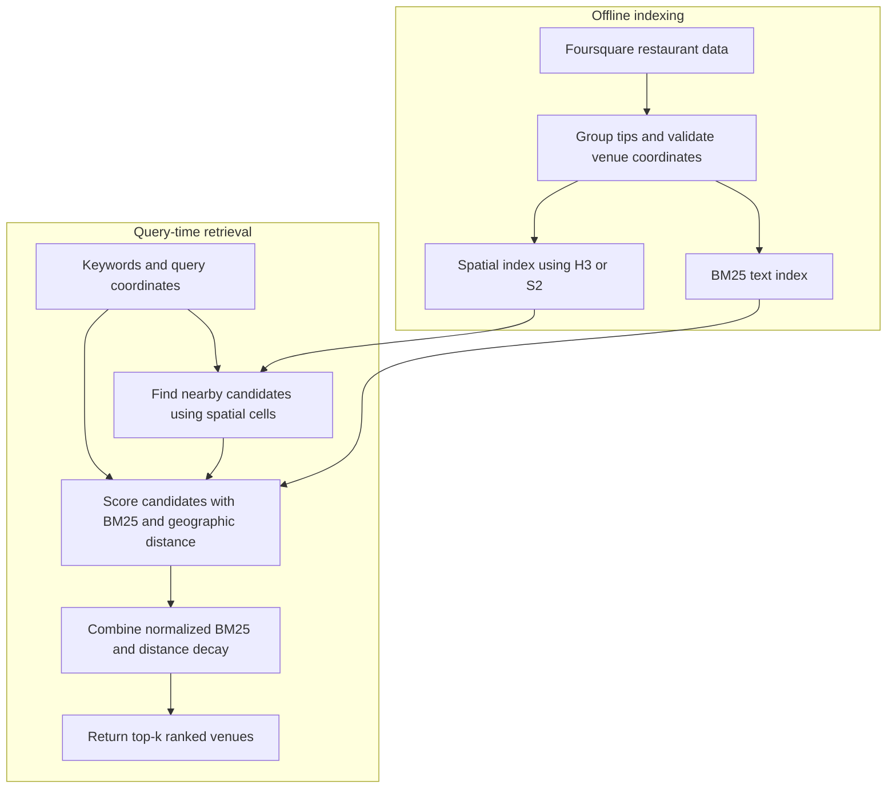
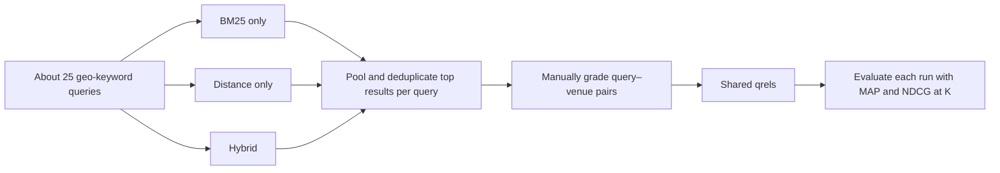

# GeoSearch-IR

**A Hybrid Spatio-Textual Search Engine for Point-of-Interest Retrieval**  
CS 410 Term Project · Fall 2026

GeoSearch-IR is a planned search engine for finding New York City restaurants that match both a keyword query and a location. For a request like “quiet café with outdoor seating near Union Square,” the engine will use restaurant tips to estimate textual relevance and geographic distance to favor nearby venues. The project will compare a hybrid ranker with text-only and distance-only baselines.

## Team

- Taeyang Song (`taeyang4`), project coordinator
- Isaac Simms (`isimms2`)
- Suman Mookherjee (`sumanm2`)
- Swarvanu Sanyal (`ssanyal4`)

## Team work division

### Swarvanu Sanyal (`ssanyal4`) — Data, spatial indexing, and ranking direction

- Prepare the initial restaurant data for indexing.
- Implement the R-tree spatial index over restaurant coordinates.
- Define the distance-decay ranking function that reranks BM25-retrieved documents.
- Set the project's overall technical direction.

### Suman Mookherjee (`sumanm2`) — BM25 indexing and text retrieval

- Prepare the BM25 index over restaurant documents.
- Implement the method that queries documents through the BM25 index.

### Taeyang Song (`taeyang4`) — End-to-end hybrid query pipeline

- Implement the complete query mechanism.
- Apply spatial filtering first, then BM25 retrieval over the filtered restaurant documents.
- Rerank the filtered BM25 results with Swarvanu's spatial distance-decay function.

### Isaac Simms (`isimms2`) — Evaluation data and evaluation

- Prepare the evaluation dataset.
- Evaluate the retrieval results using the agreed measures.

All teammates will fine-tune the algorithm, fix integration issues, and prepare the final report.

## Dataset

The project uses Dingqi Yang’s **Foursquare NYC Restaurant Rich Dataset**. It covers October 24, 2011 through February 20, 2012 and contains 3,298 venues, 3,112 users, 27,149 check-ins, and 10,377 English-language tips, along with venue tags. Choose the **NYC Restaurant Rich Dataset (Check-ins, Tips, Tags)** entry for the archive and its schema notes. [Dataset download and documentation](https://sites.google.com/site/yangdingqi/home/foursquare-dataset)

- **Retrieval unit.** Build one document per venue ID by grouping that venue’s tips. Join venue metadata and validate coordinates for spatial indexing. Record how many venues have usable text and coordinates after preprocessing.
- **Text signal.** Index tip text with BM25. Tips can provide evidence about dishes, atmosphere, and amenities.
- **Spatial signal.** Use validated venue latitude and longitude. Confirm coordinate coverage during ingestion and document how missing coordinates are handled. The experiment uses historical venue records and tips.

Dataset citation: Dingqi Yang, Daqing Zhang, Zhiyong Yu, and Zhiwen Yu. “Fine-Grained Preference-Aware Location Search Leveraging Crowdsourced Digital Footprints from LBSNs.” UbiComp 2013. [Paper](https://www-public.imtbs-tsp.eu/~zhang_da/pub/UbiComp_2013_Yang.pdf)

## Planned search workflow

The spatial index will find candidate venues in cells covering the search area. The ranker will compute great-circle distance from the query coordinates to each candidate venue and apply a decay function so closer venues receive a higher spatial score. The planned hybrid score is a weighted sum of normalized BM25 and the distance-decay score. The spatial index, candidate radius, decay scale, and ranking weight are design choices to test.

## Planned evaluation

1. Write approximately 25 realistic queries. Each topic will specify keywords, a latitude and longitude, and a short description of the intended result.
2. Run **BM25-only**, **distance-only**, and **hybrid** retrieval against a common venue corpus. Pool their top results for each query and deduplicate by venue ID.
3. Grade each pooled query–venue pair using the topic description, available tip evidence, and geographic proximity. Use a proposed scale of **0** (irrelevant), **1** (partially relevant), and **2** (highly relevant). Record the grades as relevance judgments (qrels).
4. Evaluate all runs against the same qrels. Use **MAP** for binary relevance with grades 1 and 2 counted as relevant, and **NDCG@K** for graded relevance near the top of the ranking. Record the pool depth and evaluation cutoff with the results.
5. Measure end-to-end query latency over repeated runs on the same hardware. Report median and 95th-percentile latency for each approach.

## Course submissions

- **Progress report** — [PDF](output/pdf/GeoSearch-IR_Progress_Report.pdf)
- **Project code and documentation** — submission link pending
- **Project presentation** — submission link pending

`#SpatioTextualSearch` `#GeoAwareRanking` `#SpatialIndexing` `#POIRetrieval` `#HybridSearch`
