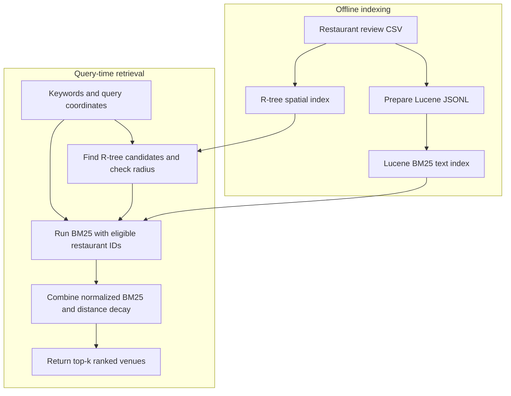
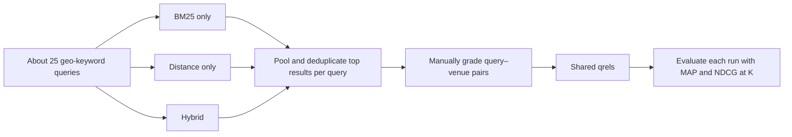

# GeoSearch-IR

**A Hybrid Spatio-Textual Search Engine for Point-of-Interest Retrieval**  
CS 410 Term Project · Fall 2026

GeoSearch-IR finds restaurants that match both a keyword query and a location. It uses restaurant descriptions and reviews for text retrieval, then considers distance from the query location when ranking the results. The planned evaluation compares hybrid search with text-only and distance-only baselines.

## Team

- Taeyang Song (`taeyang4`), project coordinator
- Isaac Simms (`isimms2`)
- Suman Mookherjee (`sumanm2`)
- Swarvanu Sanyal (`ssanyal4`)

## Team work division

### Swarvanu Sanyal (`ssanyal4`) — Data, spatial indexing, and ranking direction

- Prepare the initial restaurant data for indexing.
- Implement the R-tree spatial index over restaurant coordinates.
- Define the distance-decay ranking function that reranks BM25-retrieved documents.
- Set the project's overall technical direction.

### Suman Mookherjee (`sumanm2`) — BM25 indexing and text retrieval

- Prepare the BM25 index over restaurant documents.
- Implement the method that queries documents through the BM25 index.

### Taeyang Song (`taeyang4`) — End-to-end hybrid query pipeline

- Implement the complete query mechanism.
- Apply spatial filtering first, then BM25 retrieval over the filtered restaurant documents.
- Rerank the filtered BM25 results with Swarvanu's spatial distance-decay function.

### Isaac Simms (`isimms2`) — Evaluation data and evaluation

- Prepare the evaluation dataset.
- Evaluate the retrieval results using the agreed measures.

All teammates will fine-tune the algorithm, fix integration issues, and prepare the final report.

## Hybrid query integration

Taeyang's integration module is implemented in [`src/search/hybrid_search.py`](src/search/hybrid_search.py). It accepts a spatial candidate provider and a filtered BM25 search function, then performs the following steps.

1. Validates the query, coordinates, radius, and ranking weights.
2. Applies an exact great-circle radius check to R-tree candidates.
3. Sends eligible restaurant IDs to the shared BM25 search function, which applies a Lucene filter on the indexed `id` field.
4. Normalizes BM25 scores, applies a distance-decay score, and returns deterministic top-k results with names, addresses, distances, and component scores.

From the repository root, use Python 3.12 and Java 21. Set `JAVA_HOME` for your JDK if your environment does not already expose it. [Pyserini installation guide](https://github.com/castorini/pyserini#-installation)

```bash
python -m pip install 'pyserini==1.2.0' pandas rtree geopy flask
python -m src.text.bm25_search --build-only
python -m src.scripts.run_hybrid_query \
  --query 'pizza' --latitude 36.12 --longitude -115.17
```

The build writes `geosearch_work/index`. Use `--rebuild` on the build command after changing the corpus. For a custom index, pass `--lucene-index` to the query command and provide the matching `--jsonl` and `--csv` files. Run `python -m src.text.bm25_search` for interactive text-only search using the same index.

The hybrid CLI writes a ranked JSON array. Each result includes the restaurant ID, name, address, distance in meters, raw BM25 score, spatial score, and final score. The array order gives the rank. For evaluation runs, set `--top-k` and `--candidate-limit` to the desired return and candidate depths, with the candidate depth at least as large as the return depth. A query with no eligible results returns `[]`.

Run the integration tests with:

```bash
python -m unittest discover -s tests -v
```

## Dataset

The current implementation uses the restaurant-review CSV at [`src/resources/restaurant_reviews.csv`](src/resources/restaurant_reviews.csv) and the prepared collection at [`data/restaurants.jsonl`](data/restaurants.jsonl). The prepared collection contains 13,144 restaurant IDs. It uses the CSV's `business_id` as the Lucene `id`, and combines reviews and restaurant attributes in `contents`.

To regenerate the prepared collection from the checked-in CSV, run:

```bash
python -m src.scripts.prepare_lucene_docs --input src/resources --output data
```

## Search workflow



The R-tree narrows the spatial search, then the pipeline applies a great-circle distance check. Lucene restricts BM25 results to the eligible IDs before returning the top text candidates. The hybrid ranker combines normalized BM25 with exponential distance decay.

## Planned evaluation

1. Write approximately 25 realistic queries. Each topic will specify keywords, a latitude and longitude, and a short description of the intended result.
2. Run **BM25-only**, **distance-only**, and **hybrid** retrieval against a common venue corpus. Pool their top results for each query and deduplicate by venue ID.
3. Grade each pooled query–venue pair using the topic description, available review and attribute evidence, and geographic proximity. Use a proposed scale of **0** (irrelevant), **1** (partially relevant), and **2** (highly relevant). Record the grades as relevance judgments (qrels).
4. Evaluate all runs against the same qrels. Use **MAP** for binary relevance with grades 1 and 2 counted as relevant, and **NDCG@K** for graded relevance near the top of the ranking. Record the pool depth and evaluation cutoff with the results.
5. Measure end-to-end query latency over repeated runs on the same hardware. Report median and 95th-percentile latency for each approach.



## Setup

### Dependencies

For the geographic utilities, install:

```bash
python -m pip install pandas rtree geopy simplekml
```

### Geo pipeline

All scripts are run from the repo root.

**1. Build the RTree spatial index**

Reads `src/resources/restaurant_reviews.csv`, indexes all venues with valid coordinates, and runs a sample nearby query to verify the index.

```bash
python src/geo/create_geo_index.py
```

**2. Create GeoJSON from CSV**

Reads lat/lon and metadata from the CSV and writes a GeoJSON FeatureCollection.

```bash
python src/geo/create_geojson_from_pose.py
```

Output: `src/resources/restaurant_reviews.geojson`

**3. Create KML from GeoJSON**

Reads the GeoJSON and writes a KML file with floating pins at 10 m above ground and vertical extrusion lines to the surface.

```bash
python src/geo/create_kml_from_geojson.py
```

Output: `src/resources/restaurant_reviews.kml`

---

## Web app

The validation webapp plots all 13,144 restaurants on an interactive Leaflet map and lets you run hybrid searches visually.

**1. Install Flask**

```bash
python -m pip install flask
```

**2. Build the BM25 index** (skip if `geosearch_work/index` already exists)

```bash
python -m src.text.bm25_search --build-only
```

**3. Start the server**

```bash
conda activate pyserini
python -m src.webapp.app
```

Then open `http://localhost:5000` in your browser.

Use the same Python 3.12 / Java 21 environment as the hybrid CLI. The first search initializes Pyserini and loads the spatial data. Later searches reuse the R-tree and restaurant metadata. Restart the server after regenerating data or rebuilding the index.

An invalid query parameter returns a JSON error with HTTP 400. Top K supports 1 through 50 results. If the Lucene index is missing, the app returns HTTP 503 with the build command. Other search failures return a JSON error while the server log records the underlying exception. If port 5000 is occupied, run `python -m flask --app src.webapp.app run --port 5001` and open `http://localhost:5001`.

**Features**

- All restaurants appear as grey dots on load (canvas-rendered for performance)
- Click anywhere on the map to set that position as your query location
- Use **📍 My Location** to fill lat/lon from the browser's geolocation API
- Search form accepts: query text, latitude, longitude, radius (miles), top-k
- Results appear as red highlighted markers; a ranked sidebar shows name, distance, BM25/spatial/final scores
- Clicking a sidebar card zooms the map to that restaurant and opens its popup
- Popups show full restaurant details: stars, review count, cuisine label, price range, and attribute badges (takeout, outdoor seating, WiFi, alcohol, noise level, etc.)
- **💾 Save State** captures the last completed query, coordinates, parameters, and results to `localStorage` for later reload
- Saved states capture the last completed search. Searches and saved-state loading wait for restaurant markers to load, and older search responses are ignored after a newer search starts.
- Enter an optional saved-search name in the sidebar, then click Save State. Saving uses the page controls and works in browsers that disable JavaScript prompt dialogs.

---

## Course submissions

- **Progress report** — [PDF](output/pdf/GeoSearch-IR_Progress_Report.pdf)
- **Project code and documentation** — submission link pending
- **Project presentation** — submission link pending

`#SpatioTextualSearch` `#GeoAwareRanking` `#SpatialIndexing` `#POIRetrieval` `#HybridSearch`
